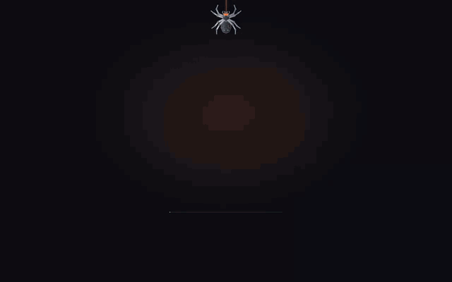
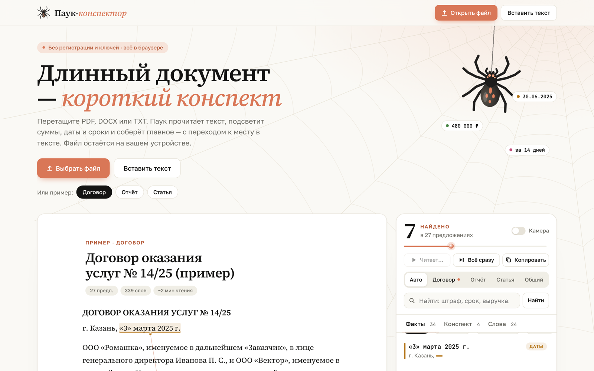
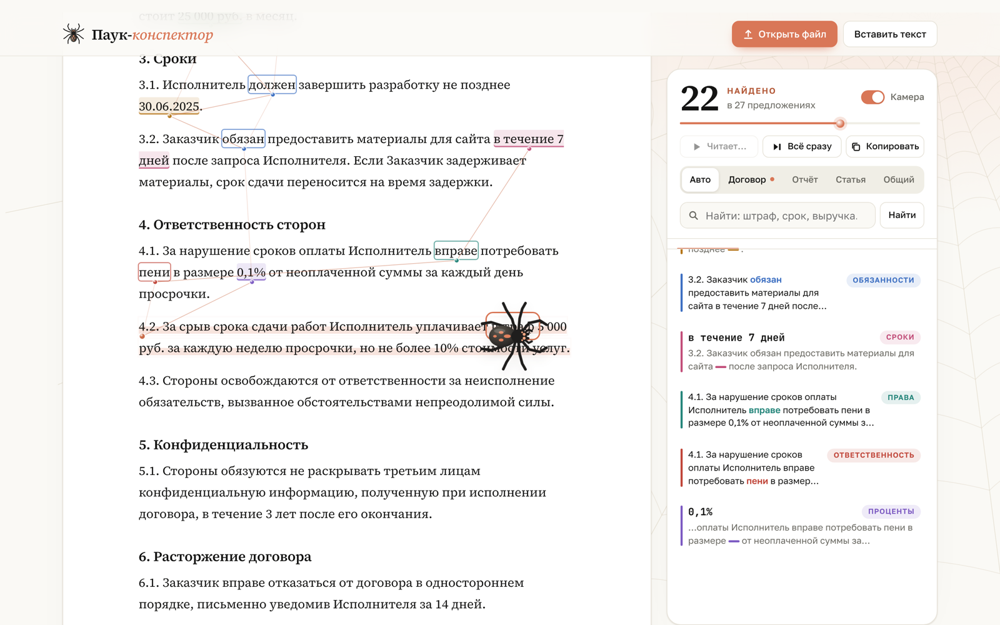
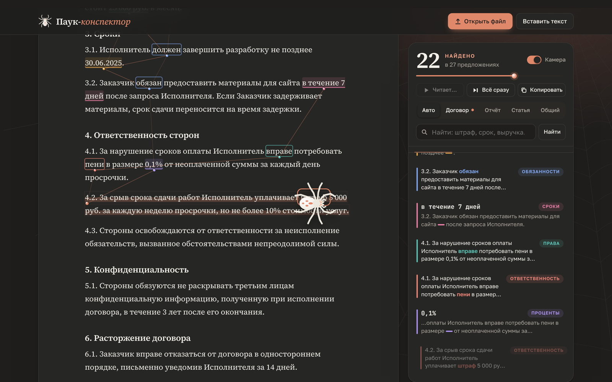
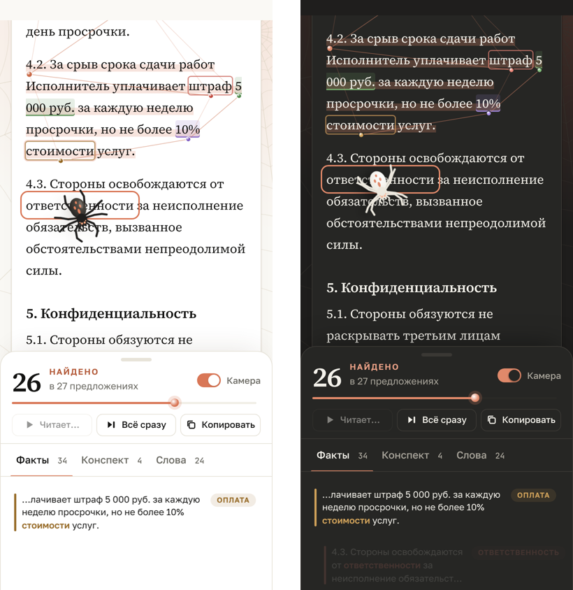
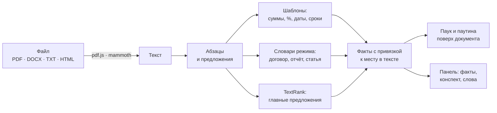

# Паук-конспектор

### Длинный документ — *короткий конспект*

Один HTML-файл, который читает за вас договоры, отчёты и статьи. 
Перетащите PDF, DOCX или TXT — паук пробежит по тексту, подсветит суммы, даты и сроки 
и соберёт главное, а каждый пункт приведёт к месту в документе, откуда он взят.

 

**[Скачать index.html](index.html)** &nbsp;·&nbsp; [Как пользоваться](#-как-пользоваться) &nbsp;·&nbsp; [Что находит паук](#-что-находит-паук) &nbsp;·&nbsp; [Как это работает](#-как-это-работает)

 

## ✦ Зачем это

Длинные документы читают по диагонали и пропускают важное: сумму штрафа, срок оплаты, право расторгнуть договор. Паук-конспектор вытаскивает такие вещи сам и показывает, **где именно** они написаны. Конспект собирается из предложений самого документа, поэтому ничего не выдумано: любой пункт можно проверить за секунду.

Всё работает прямо в браузере. Файл никуда не отправляется, регистрация и ключи не нужны.

## ✦ Возможности

<table>
<tr>
<td width="50%" valign="top">

**🕷 Живой паук** 
Большой паук бежит по тексту, подсвечивает находки и плетёт между ними паутину. Камера следует за ним, а в покое он отходит на поля и не закрывает текст.

</td>
<td width="50%" valign="top">

**📌 Факты со ссылкой на источник** 
Суммы, проценты, даты и сроки собираются в список. Нажмите на любой пункт — страница прокрутится к нему, а паук подбежит и покажет место.

</td>
</tr>
<tr>
<td valign="top">

**📝 Конспект из главных предложений** 
Алгоритм TextRank выбирает самые важные предложения и выстраивает их в порядке текста под заголовками разделов.

</td>
<td valign="top">

**🧭 Режимы: договор, отчёт, статья** 
Режим определяется сам. В договоре паук ищет обязанности, штрафы и расторжение, в отчёте — выручку, долг и риски, в статье — цель, метод и выводы.

</td>
</tr>
<tr>
<td valign="top">

**🔎 Поиск и облако слов** 
Введите слово — паук пробежит по всем подходящим предложениям. Частые слова документа собраны в облако: чем крупнее, тем чаще.

</td>
<td valign="top">

**✨ Анимации и тёмная тема** 
Заставка, на которой паук плетёт паутину, плавное появление интерфейса, светлая и тёмная тема. С настройкой «уменьшить движение» анимации отключаются.

</td>
</tr>
</table>

## ✦ Как это выглядит

<table>
<tr>
<td width="50%"></td>
<td width="50%"></td>
</tr>
<tr>
<td align="center">Светлая тема</td>
<td align="center">Тёмная тема</td>
</tr>
</table>

   
  На телефоне находки собираются в выдвижной панели снизу

## ✦ Как пользоваться

1. **Скачайте [`index.html`](index.html)** и откройте его двойным щелчком в любом современном браузере.
2. **Дайте пауку документ** — один из способов:
   - нажмите «Выбрать файл» и выберите PDF, DOCX, TXT, MD или HTML;
   - перетащите файл прямо на страницу;
   - нажмите «Вставить текст» или просто вставьте текст сочетанием <kbd>Ctrl</kbd>+<kbd>V</kbd>.
3. **Смотрите, как он читает.** Находки появляются в панели справа (на телефоне — снизу).

| Кнопка | Что делает |
| --- | --- |
| **Ещё раз** | Пустить паука по документу заново |
| **Всё сразу** | Показать все находки без анимации |
| **Копировать** | Скопировать конспект и факты в буфер обмена |
| **Камера** | Включить или выключить слежение за пауком |
| **Авто · Договор · Отчёт · Статья · Общий** | Сменить режим разбора |

> [!TIP]
> Нет своего документа под рукой? На первом экране есть три примера: договор, годовой отчёт и научная статья. Все данные в них вымышленные.

### Свой сайт за минуту

Страницу можно бесплатно выложить на GitHub Pages: **Settings → Pages → Deploy from a branch**, выберите ветку и папку `/ (root)`. Через минуту сайт откроется по адресу `https://<ваш-логин>.github.io/Web-Crawler/`.

## ✦ Что находит паук

**Во всех режимах**

| Категория | Примеры | Как ищется |
| --- | --- | --- |
| 💰 Суммы | `480 000 (четыреста восемьдесят тысяч) рублей`, `12,4 млрд руб.`, `$3.25T` | шаблоны чисел с валютой и масштабом |
| ％ Проценты | `30%`, `0,1%`, `10–12%` | числа и диапазоны со знаком процента |
| 📅 Даты | `30.06.2025`, `«3» марта 2025 г.`, `March 28, 2025` | русские и английские форматы дат |
| ⏳ Сроки | `в течение 5 (пяти) рабочих дней`, `за 14 дней`, `within 12 months` | число + единица времени + предлог |
| ⭐ Главное | ключевые предложения документа | TextRank по общим словам между предложениями |

**По режимам**

| Режим | Категории |
| --- | --- |
| **Договор** | Обязанности · Права · Ответственность · Оплата · Расторжение · Конфиденциальность |
| **Отчёт** | Выручка · Прибыль · Долг · Риски · Акции · Прогноз |
| **Статья** | Цель · Метод · Результаты · Выводы · Ограничения |
| **Общий** | только суммы, проценты, даты, сроки и главное |

## ✦ Как это работает

1. **Чтение.** PDF разбирается библиотекой pdf.js: строки собираются в абзацы по расстояниям между ними. DOCX читается через mammoth, у TXT сама определяется кодировка, включая Windows-1251.
2. **Разметка.** Текст делится на абзацы и предложения с учётом сокращений («г.», «руб.», «т. е.», инициалы, нумерация «1.1.»).
3. **Поиск фактов.** Регулярные выражения находят суммы, проценты, даты и сроки. Словари режима отмечают предложения про обязанности, риски, выводы и так далее.
4. **Конспект.** TextRank строит граф предложений по общим словам и выбирает самые «центральные». Для очень длинных текстов используется более быстрая оценка по редким повторяющимся словам.
5. **Показ.** Документ рисуется с подсветкой, поверх него в SVG плетётся паутина, и паук обходит находки в порядке текста.

## ✦ Под капотом

- **Один файл ~116 КБ** без сборки и зависимостей: чистые HTML, CSS и JavaScript, SVG и Canvas для графики.
- **Библиотеки загружаются только при необходимости** с jsDelivr: [pdf.js 3.11.174](https://github.com/mozilla/pdf.js) — для PDF, [mammoth 1.6.0](https://github.com/mwilliamson/mammoth.js) — для DOCX.
- **Шрифты:** Source Serif 4, Golos Text и JetBrains Mono из Google Fonts, с запасными системными шрифтами.
- **Скорость:** документ на ~7 000 предложений (больше 200 страниц) разбирается и показывается целиком примерно за 4 секунды.
- **Доступность:** светлая и тёмная тема, адаптив под телефон, управление с клавиатуры, поддержка `prefers-reduced-motion`.

<b>Устройство кода</b>

 

Скрипт внутри `index.html` разбит на пронумерованные разделы:

| Раздел | Что внутри |
| --- | --- |
| 1. Helpers | мелкие утилиты, заставка, рисунок паука, фоновая паутина |
| 2. Patterns | регулярные выражения для значений и словари режимов |
| 3. Text → sentences | абзацы, заголовки, деление на предложения |
| 4. Analysis | поиск фактов, TextRank, частые слова |
| 5. Rendering | вывод документа с подсветкой |
| 6. Web & spider | SVG-паутина, движение паука, камера |
| 7. Main run | обход документа и наполнение панели |
| 8. Panel | факты, фильтры, конспект, облако слов |
| 9. Search | поиск по документу |
| 10. Reading files | PDF, DOCX, HTML, TXT |
| 11–13. App | загрузка текста, примеры, обработчики событий |

## ✦ Ограничения

- Конспект состоит из **выдержек**: это предложения самого текста, пересказа своими словами нет.
- **Сканы PDF** без текстового слоя не распознаются.
- Для первого открытия **PDF и DOCX нужен интернет**, чтобы загрузились библиотеки чтения. TXT, MD, HTML и вставка текста работают офлайн.
- Старый формат **`.doc`** не поддерживается — сохраните файл как `.docx` или PDF.
- Шаблоны иногда ошибаются: например, «до 24 лет» в значении возраста попадёт в сроки.

## ✦ Идеи на будущее

- [ ] Распознавание сканов (OCR) прямо в браузере
- [ ] Сравнение двух версий договора: что добавили, что убрали
- [ ] Экспорт конспекта в Markdown и Excel
- [ ] Пересказ своими словами через ИИ по собственному ключу (по желанию)

 

Сделано с любовью к длинным документам и маленьким паукам 🕷

